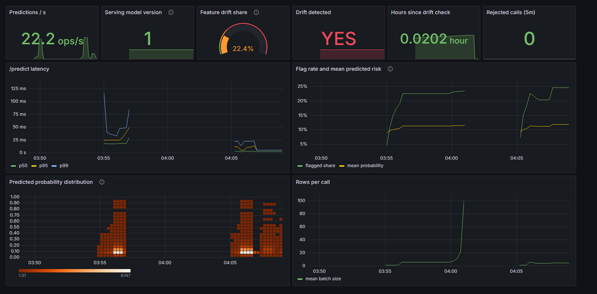

# ML Pipeline + MLOps: 30-Day Readmission Risk

An end-to-end model lifecycle on real hospital data: validated and versioned data, tuned
models, a registry with a statistical promotion gate, a containerised API on Kubernetes,
and drift monitoring that triggers retraining. Every number below is measured and
reproducible with one command.

> Part of the Live Projects portfolio. See [SHARED_STANDARDS.md](../SHARED_STANDARDS.md) for conventions and the milestone definition of done.

**Results at a glance**

* **The promotion gate did its job.** A 50-trial Optuna-tuned XGBoost reached test ROC-AUC
  0.677 vs 0.668 for the logistic-regression baseline on 14,851 held-out encounters. The
  lift is real (paired-bootstrap 95% CI [+0.001, +0.016]) but below the +0.01 the gate
  requires to swap models, so the simpler model stays in production.
* **Audited, not just scored.** Both models are well calibrated (ECE 0.0075 and 0.0039).
  Flagging the top 10% of risk scores catches 24-25% of readmissions, 2.4-2.5× random. The
  largest subgroup gap is age, not race or sex: AUC 0.745 under 40 vs 0.619 over 80 for the
  baseline. Dropping race as a feature changes AUC by 0.0002.
* **Drift detection within one batch.** Over 20 batches of 1,000 encounters per scenario,
  the alarm rule caught 4 of 5 simulated shifts in 20/20 batches, with 0/20 false alarms on
  unshifted data. The usual "share of drifted features" rule alone caught none of them.
* **Retraining is gated too.** After a simulated EHR code remap, the deployed model fell
  from AUC 0.668 to 0.607. A model retrained on post-shift data recovered 0.668, and the
  gate promoted it (lift +0.061, CI [+0.048, +0.074]).
* **Fast serving.** A verified fast encoding path cut server-side `/predict` time for one
  record by 30× (about 21 ms → 0.70 ms). End-to-end p50 is 3.2 ms on the host.
* **Reproducible, with the limits measured.** `dvc repro` on Linux rebuilt the pipeline
  from the raw download with bit-identical processed data and the baseline within 0.0003
  AUC of the Windows run. The 50-trial XGBoost search did not reproduce (0.672 on Windows,
  0.677 on Linux); see [Reproducibility](#reproducibility).

## Overview

Hospitals are penalised for 30-day readmissions, and a risk score at discharge decides who
gets follow-up calls and home visits. A model like that is only useful if it is
**trustworthy over time**: trained on validated data, promoted only when it is really
better, and watched for the day the incoming data stops looking like the training data.

**Data:** [UCI Diabetes 130-US Hospitals (1999-2008)](https://archive.ics.uci.edu/dataset/296)
(CC BY 4.0). It has 101,766 inpatient encounters of 71,518 diabetic patients. The target is
readmission within 30 days (`readmitted == "<30"`, 11.1% positive). 2,423 encounters that
ended in death or hospice are dropped because they cannot be readmitted. Train, validation
and test (70/15/15) are split **by patient**, so no patient appears in two splits.

What the project shows:

- Data versioned with **DVC** and validated with **Pandera** before it reaches a model
- Training with scikit-learn and **XGBoost**, tuned with **Optuna**, explained with **SHAP**
- An **MLflow** registry with `challenger` / `champion` aliases and a statistical promotion gate
- A **FastAPI** service in an immutable Docker image, deployed to **Kubernetes**
- **Evidently** drift monitoring, Prometheus alerts and a Grafana dashboard
- **GitHub Actions** that retrains, gates, builds the image and deploys it to a kind cluster

## Tech Stack

| Layer | Tools |
|---|---|
| Data versioning / validation | DVC (local remote), Pandera |
| Training / tuning / explainability | scikit-learn, XGBoost, Optuna (TPE), SHAP |
| Tracking / registry | MLflow 3 (SQLite store, model aliases, skops serialisation) |
| Serving | FastAPI, Uvicorn, Docker, Kubernetes (kind / Docker Desktop) |
| Monitoring | Evidently, Prometheus, Grafana |
| CI/CD | GitHub Actions (lint, tests, `dvc repro`, gate, image build, kind deploy) |

## Architecture

```
 UCI download ──► DVC: fetch ─► prepare (Pandera raw + processed schemas, patient-grouped split)
                                    │
                    ┌───────────────┴───────────────┐
                    ▼                               ▼
          train_baseline (LogReg)        train_xgboost (Optuna, early stopping)
                    │  params, metrics, SHAP, model │
                    └──────► MLflow registry ◄──────┘
                              (challenger alias)
                                    │
                         gate: paired bootstrap on test
                         lift >= 0.01 and CI > 0, Brier no worse
                                    │ passes → champion alias
                                    ▼
             export bundle (model + threshold + key features + reference sample)
                                    │ COPY into image
                                    ▼
   clients ──► FastAPI /predict (2 replicas on Kubernetes) ──► per-pod inference log (PVC)
                    │ /metrics                                     │
                    ▼                                              ▼
            Prometheus ──► Grafana                  CronJob: Evidently drift check
               ▲   alerts                                          │
               └──────── mlp_drift_* gauges ◄── reports/drift ◄─────┘
                                                                   │ drift
                                                                   ▼
                                                 retrain challenger ──► gate
```

| Component | Responsibility |
|---|---|
| `data.py` | Download, history features, patient-grouped split; writes `data/processed/` and `reports/data_profile.json` |
| `validation.py` | Pandera schemas for raw (types, ranges, category sets, unique ids) and processed data; every failure reported at once |
| `train.py` | Baseline and XGBoost trainers; threshold chosen on validation; MLflow logging, SHAP artifacts, registration as `challenger` |
| `promote.py` | The gate: compares challenger and reference on the same test rows and moves `champion` only on a significant lift |
| `export.py` | Champion → `model_bundle/` (model, threshold, key features, reference sample), so the image needs no tracking server |
| `serve.py` | `/predict` with strict schema validation, `/ready` vs `/health`, Prometheus metrics, asynchronous inference logging |
| `fastpath.py` | Verified fast encoder for small requests (30× lower server time than the sklearn path) |
| `monitor.py` | Evidently per-feature tests; alarm on drift share, key-feature drift or output drift; optional retrain + gate |
| `simulate.py` | Drift scenarios, end-to-end loop through the API, retrain demo |

## Setup

### Prerequisites
- Python 3.11
- Git (DVC builds on top of git)
- Docker Desktop (for `docker compose` and the image)
- `kubectl` plus **kind** or Docker Desktop Kubernetes for the cluster deploy
- Optional: GNU Make (see the Windows note below)

### Install
```bash
git clone https://github.com/GunjanPR/03-ml-pipeline-mlops.git && cd 03-ml-pipeline-mlops
py -3.11 -m venv .venv            # Windows; on macOS/Linux use: python3.11 -m venv .venv
source .venv/Scripts/activate     # Git Bash; PowerShell: .venv\Scripts\Activate.ps1; macOS/Linux: source .venv/bin/activate
make install                      # = pip install -e ".[dev]"
```
The core install (`pip install .`) is what the serving image uses. The `train` and
`monitor` extras add Optuna, SHAP, DVC and Evidently.

### Environment config
```bash
cp .env.example .env              # optional; every setting has a default
```
Experiment parameters (seed, Optuna trials, gate lift, drift threshold) live in
`params.yaml`, which DVC tracks. Environment variables and `.env` override them.
MLflow uses a local SQLite store (`mlflow.db`), because MLflow 3 no longer accepts the
`./mlruns` file store.

## How to Run

> **Windows note:** `make` isn't installed on Windows by default. Install it with `choco install make`, or run the
> targets from **Git Bash**. You can also run the commands in the `Makefile` yourself
> (for example, `python -m pytest` instead of `make test`).

### Train, gate and inspect
```bash
make repro        # dvc repro: fetch -> prepare -> train baseline + xgboost -> gate (about 4 min)
dvc metrics show  # metrics from reports/*.json; `dvc metrics diff` compares commits
make mlflow-ui    # runs, SHAP plots and the registry on http://localhost:5000
```
Single steps: `make data`, `make run` (baseline), `make train-xgboost`, `make gate`.
Ablations never touch the registry:
`python -m ml_pipeline.train --model baseline --exclude prior_encounters,total_prior_visits`.

### Serve locally, with Docker, or on Kubernetes
```bash
make serve                       # API on http://localhost:8020 straight from the registry
make up                          # export bundle, build image, start API + Prometheus (:9092) + Grafana (:3002)
make k8s-deploy                  # image + kubectl apply -k k8s/ (see k8s/README.md)
curl -X POST localhost:8020/predict -H 'Content-Type: application/json' -d @examples/request.json
```

### Monitor drift
```bash
make monitor     # Evidently check of the inference log against training data (exit 3 = drift)
make simulate    # all drift scenarios, the end-to-end API loop and the retrain demo
python -m ml_pipeline.monitor --retrain   # drift-triggered job: retrain challenger + gate
```

### Lint and test
```bash
make lint     # ruff check + ruff format --check
make test     # pytest: 63 tests, no network or Docker needed
make coverage # the same with line coverage (73%; fails below 70%)
make audit    # calibration, top-k and subgroup report -> reports/audit.md
make format   # auto-fix lint and formatting
```

## Evaluation & Results

**Protocol.** Hyperparameters, early stopping and the F1 decision threshold are all chosen on
the validation split. The test split (14,851 encounters, 10,499 patients, 11.1% positive) is
scored once. ROC-AUC CIs are 1,000-sample bootstraps. Hardware: Intel Core i5-13420H
(8 cores), 16 GB RAM, Windows 11, on AC power.

### Models (named baseline: logistic regression on the same features and split)

| Model | Test ROC-AUC (95% CI) | PR-AUC | F1 @ val threshold | Brier | Fit time | Predict |
|---|---|---|---|---|---|---|
| **Logistic regression (baseline, champion)** | 0.668 (0.653-0.681) | 0.220 | 0.273 | 0.0945 | 3.2 s | 8.6 ms / 1k rows |
| XGBoost, 50 Optuna trials | 0.677 (0.663-0.691) | 0.239 | 0.286 | 0.0933 | 198 s | 12.2 ms / 1k rows |

Metrics are from the committed `dvc repro` (`reports/*_metrics.json`, Linux, 2026-10-19).
Fit and predict times are from the Windows laptop run (`reports/history/v2_windows_*`),
because the Linux run shared four vCPUs with another job.

**Gate decision: blocked.** The AUC lift is +0.0087 with paired-bootstrap 95% CI
[+0.0014, +0.0160]. XGBoost is measurably better, but the lift is below the +0.01 the gate
requires before it swaps a production model. The champion stays the logistic regression,
which is about 60x cheaper to train and fully interpretable. That is the gate working as
designed: a statistically real but small gain is not enough on its own.

What did not help (measured, kept for honesty):

| Change | Effect on test ROC-AUC |
|---|---|
| Patient-history features (prior encounters, prior 30-day readmissions, prior-year visits) | +0.0003 for the baseline (0.6679 → 0.6682); `number_inpatient` already carries this signal |
| Detailed 3-digit ICD-9 codes instead of 9 disease groups (experiment) | within ±0.005 on validation |

This matches published work on this dataset, where ROC-AUC tops out around 0.65-0.70: the
remaining signal is not in these administrative fields. SHAP puts discharge disposition,
prior inpatient stays, missing payer code and missing specialty at the top for both models.

### Calibration, decision value and subgroups (`reports/audit.md`)

ROC-AUC says how well a model ranks patients. Before a score decides who gets a follow-up
call, `python -m ml_pipeline.audit` (a DVC stage after the gate) checks three more things on
the same test rows: calibration, how many readmissions a fixed-size follow-up list catches,
and the same metrics by age band, sex and race with bootstrap 95% CIs.

| Model | ECE | Predicted / observed risk | Top 10% of scores: recall, precision, lift | Top 20% |
|---|---|---|---|---|
| Logistic regression | 0.0075 | 1.035 | 23.7%, 26.3%, 2.37× | 38.3%, 21.3%, 1.92× |
| XGBoost | 0.0039 | 1.023 | 25.4%, 28.2%, 2.54× | 40.4%, 22.4%, 2.02× |

Subgroups (logistic regression, deployed threshold 0.132):

| Group | n | Readmitted | ROC-AUC (95% CI) | Sensitivity (95% CI) |
|---|---|---|---|---|
| Age < 40 | 943 | 11.1% | 0.745 (0.691-0.803) | 0.533 (0.430-0.626) |
| Age 40-59 | 4,008 | 10.5% | 0.701 (0.673-0.726) | 0.391 (0.348-0.438) |
| Age 60-79 | 7,031 | 11.2% | 0.656 (0.635-0.675) | 0.446 (0.413-0.482) |
| Age 80+ | 2,869 | 11.8% | 0.619 (0.587-0.652) | 0.475 (0.422-0.527) |
| Female / Male | 7,990 / 6,861 | 11.0% / 11.3% | 0.676 / 0.659 | 0.466 / 0.419 |
| African American / Caucasian | 2,764 / 11,177 | 10.4% / 11.4% | 0.675 / 0.663 | 0.451 / 0.447 |

- **Calibration is good for both models**: a predicted 11% means about 11%, overall and in
  every subgroup with enough readmissions (predicted/observed 0.97-1.12).
- **Age is the real gap.** Ranking gets steadily worse with age (AUC 0.745 → 0.619), so the
  score is least useful for the oldest patients, who are readmitted most. XGBoost narrows the
  gap a little (0.761 → 0.646, gap 0.116 vs 0.126). Sex and race gaps are small (AUC within
  0.017 and 0.012) and their CIs overlap.
- **Race-blind ablation** (`train --exclude race`, `reports/audit_race_ablation.md`): AUC
  0.6679 → 0.6677 and unchanged subgroup gaps. The model gets almost nothing from race, so it
  can be dropped at no cost. Asian, Hispanic, Other and missing-race groups have fewer than 30
  readmissions in the test set, so their AUC is not reported; their sensitivity CIs are wide.

### Reproducibility

The committed reports are from `dvc repro` on Linux (Python 3.11) from the raw UCI download.
The previous reports came from the Windows laptop and are kept in `reports/history/v2_windows_*`.

| | Windows laptop | Linux re-run |
|---|---|---|
| Raw and processed data (DVC md5) | identical | identical |
| Logistic regression test AUC | 0.6682 | 0.6679 |
| XGBoost, 50 Optuna trials, test AUC | 0.6717 | 0.6765 |
| Gate lift (95% CI) | +0.0035 (-0.004, +0.011) | +0.0087 (+0.001, +0.016) |
| Gate decision | blocked | blocked |

The tuned XGBoost differs because the search took a different path. The TPE sampler is
seeded, but XGBoost's multithreaded `hist` training gives slightly different validation AUCs
on different CPUs and thread counts. After a few trials the sampler proposes different
parameters (best found: depth 5, 77 trees on Windows; depth 6, 291 trees on Linux; inferred
from the logged parameters). So **one tuned run moves test AUC by about 0.005**. That is as
large as the Windows lift, and it is why the gate asks for a +0.01 minimum lift on top of a
CI that excludes zero.

The old `dvc.lock` also hashed Windows CRLF copies of the source files, so `dvc status` on a
fresh clone reported every stage as changed. The lock now matches the LF files in git
(`.gitattributes` sets `eol=lf`).

### Drift monitoring (`reports/drift_simulation.md`)

Batches of 1,000 encounters were drawn from the held-out test patients, 20 per scenario.
The reference is 20,000 training rows. The alarm fires if **any** of these holds: ≥30% of
features drift, one of the model's **5 key features** (top mean |SHAP|) drifts, or the
predicted-probability distribution drifts.

| Scenario | Alarm rate | Share-of-features rule alone | Mean share of drifted features | Model ROC-AUC on the batch |
|---|---|---|---|---|
| No shift (false-alarm check) | **0 / 20** | 0 / 20 | 0.00 | 0.677 |
| Older, sicker case mix | **20 / 20** | 0 / 20 | 0.21 | 0.646 |
| New site, emergency intake | **20 / 20** | 0 / 20 | 0.14 | 0.669 |
| ICD-10 migration (half of codes unmappable) | **20 / 20** | 0 / 20 | 0.06 | 0.665 |
| Discharge code remap (EHR migration) | **20 / 20** | 0 / 20 | 0.02 | **0.607** |
| New lab panel (+15 lab procedures) | 0 / 20 | 0 / 20 | 0.02 | 0.665 |

The most damaging shift, a silent recode of one high-impact column, moves only 2% of
features, so a share-of-features rule can never see it. The key-feature rule catches it in
every batch. The one miss, the lab panel change, touches a low-importance feature and
barely changes accuracy. The end-to-end check sent 1,000 shifted rows through the real
`/predict` endpoint, and the monitor read them back from the inference log and raised the
alarm.

### Retraining after a shift

| Shift | Deployed model, before → after shift | Retrained on shifted data | Lift (95% CI) | Gate |
|---|---|---|---|---|
| Discharge code remap | 0.668 → 0.607 | 0.668 | +0.061 (+0.048, +0.074) | **promote** |
| ICD-10 migration | 0.668 → 0.666 | 0.668 | +0.001 (-0.001, +0.003) | keep champion |

So the drift alarm is a trigger, not a verdict. Retraining runs for both shifts, but the
same gate promotes only where retraining measurably helps.

### Serving

Measured with [`scripts/bench_api.py`](scripts/bench_api.py): 1,000 sequential
single-record calls, then 50 calls of 100 records, all from the test split
(`reports/api_latency.json`).

| Setup | Single record p50 / p95 | Server-side handler time | 100-record batch p50 | Throughput (batched) |
|---|---|---|---|---|
| uvicorn on the host | **3.2 / 4.1 ms** | **0.56 ms** | 26 ms | 3,681 rows/s |
| Docker container (Docker Desktop on Windows) | 47.5 / 49.2 ms | 0.70 ms | 25 ms | 2,738 rows/s |

On Windows, Docker Desktop's port forwarding adds about 45 ms to every call. The server's
own histogram shows the handler takes under 1 ms, so the rest is the forwarding layer.

**Optimization: single-record latency.** Profiling one `/predict` call showed about 21 ms
of server time: 14 ms in scikit-learn's `ColumnTransformer` + `OneHotEncoder`, which does
per-column bookkeeping that costs the same for 1 row as for 100, 5 ms writing the inference
log, and 2 ms building a DataFrame. Two changes fixed it:

* **A verified fast encoder** ([`fastpath.py`](src/ml_pipeline/fastpath.py)), used for
  requests of up to 32 rows. It is built from the fitted preprocessor (scaler parameters
  and the one-hot layout, including the "infrequent" bucket) and encodes records with dict
  lookups. It is switched on only after it reproduces the sklearn probabilities on the
  reference sample to within 1e-9; otherwise the API stays on sklearn. Tests check
  that it matches exactly for both model types and for unseen categories.
* **An asynchronous inference log** that writes on a background thread and flushes on
  shutdown.

Result: server-side time per single-record call fell from about 21 ms to **0.70 ms (30×)**,
and the Docker p50 fell from 64.7 ms to 47.5 ms. Larger batches still use sklearn, which is
faster per row at volume.



*Grafana dashboard during the [demo session](docs/demo.md): traffic, latency (the drop at
04:05 is the fast path going live), drift share, the drift alarm and the predicted-risk
distribution.*

## Milestones

Milestones follow [SHARED_STANDARDS.md](../SHARED_STANDARDS.md). Each one has a definition of done there.

### M1: Scaffold & baseline
- [x] Repo scaffold: `pyproject.toml`, Makefile, `.gitignore`, `.env.example`
- [x] Smoke test passes (`make test`)
- [x] Dataset chosen; baseline logistic regression trained and scored

### M2: Core functionality
- [x] Feature engineering + XGBoost training with Optuna search
- [x] MLflow tracking (params, metrics, SHAP artifacts)
- [x] FastAPI `/predict` service loading the registered model

### M3: Data / storage layer
- [x] DVC data versioning + remote
- [x] `dvc.yaml` pipeline stages; `dvc repro` reproduces end to end
- [x] Pandera data validation stage

### M4: Evaluation & testing
- [x] Unit tests for features, validation, and API
- [x] Model quality gate vs baseline (blocks registry promotion)
- [x] Evaluation report on held-out test set
- [x] Calibration, top-k and subgroup audit (age, sex, race) with bootstrap CIs; race-blind ablation
- [x] Prometheus alert rules unit-tested with `promtool test rules` in CI

### M5: Observability / monitoring
- [x] Evidently drift reports on inference logs
- [x] Prometheus metrics + Grafana dashboard; drift alert threshold
- [x] Drift-triggered / scheduled retraining job

### M6: Containerization & CI/CD
- [x] Dockerfile for the serving image
- [x] Kubernetes manifests; deploy to kind/minikube
- [x] GitHub Actions: lint, test, train-and-gate, image build

### M7: Docs, benchmarks & demo
- [x] README with measured results vs baseline
- [x] Drift simulation write-up
- [x] Demo: [recorded session transcript](docs/demo.md) with dashboard screenshot

## Project Layout
```
03-ml-pipeline-mlops/
├── src/ml_pipeline/
│   ├── config.py        # settings: params.yaml < .env < environment
│   ├── data.py          # fetch, history features, patient-grouped split
│   ├── validation.py    # Pandera raw + processed schemas
│   ├── features.py      # shared preprocessing (scaling, one-hot)
│   ├── evaluate.py      # ROC-AUC, PR-AUC, F1, Brier, bootstrap CI
│   ├── train.py         # baseline + XGBoost/Optuna, SHAP, MLflow registration
│   ├── promote.py       # champion/challenger gate (paired bootstrap)
│   ├── audit.py         # calibration, top-k capture, subgroup metrics with CIs
│   ├── export.py        # champion -> serving bundle
│   ├── serve.py         # FastAPI service, Prometheus metrics, async inference log
│   ├── fastpath.py      # verified low-latency encoder for small requests
│   ├── monitor.py       # Evidently drift check + alarm rules + retrain trigger
│   └── simulate.py      # drift scenarios, end-to-end loop, retrain demo
├── tests/               # 63 tests: data, validation, training, gate, API, fast path, drift, audit
├── dvc.yaml, dvc.lock, params.yaml
├── reports/             # committed metrics JSON, gate decision, drift simulation
├── deploy/              # Prometheus config + alert rules, Grafana dashboard
├── k8s/                 # Kustomize manifests (Deployment, Service, PVC, CronJob, HPA)
├── scripts/bench_api.py # API latency benchmark
├── examples/request.json
├── .github/workflows/ci.yml
├── Dockerfile, docker-compose.yml, Makefile, pyproject.toml
└── README.md
```
