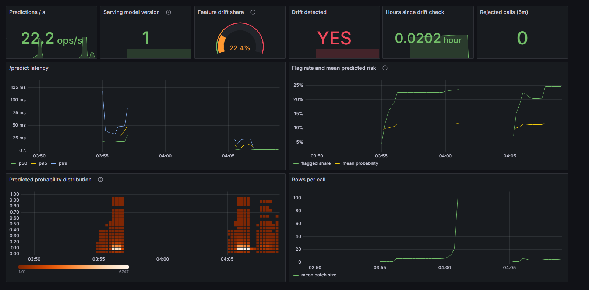

# ML Pipeline + MLOps: 30-Day Readmission Risk

An end-to-end model lifecycle on real hospital data: validated and versioned data, tuned
models, a registry with a statistical promotion gate, a containerised API on Kubernetes,
and drift monitoring that triggers retraining. Every number below is measured and
reproducible with one command.

> Part of the Live Projects portfolio. See [SHARED_STANDARDS.md](../SHARED_STANDARDS.md) for conventions and the milestone definition of done.

**Results at a glance**

* **The gate tests on the future, and it promoted XGBoost.** Models train on the earliest 70%
  of encounters and are tested on the latest 15% (14,901 encounters), as a deployed model
  would be. A 50-trial Optuna-tuned XGBoost reached ROC-AUC 0.677 vs 0.645 for the
  logistic-regression baseline: lift **+0.031 (paired-bootstrap 95% CI +0.024 to +0.039)**,
  above the +0.01 the gate requires, so XGBoost is the champion. The decision held across 5
  Optuna seeds (lift +0.031 to +0.041).
* **The split changed the decision, and that is measured.** On the earlier random
  patient-grouped split the same comparison gave +0.008 to +0.009 and the gate blocked
  XGBoost. The random split flattered the baseline (0.668 there vs 0.645 on later data), and
  the gate now refuses to compare models trained on different splits; see
  [Robustness](#robustness-of-the-comparison-reportsrobustnessmd).
* **Checked against the clinical score.** XGBoost beats the LACE readmission index (0.590 on
  the same rows) by +0.087 AUC; the baseline beats it by +0.055.
* **Audited, not just scored.** Both models rank and calibrate well (ECE 0.012-0.014), but
  over-predict by about 11% because the readmission rate fell from 11.6% in the training
  period to 10.8% in the test period. Flagging the top 10% of XGBoost's scores catches 25.1%
  of readmissions, 2.5× random. The largest subgroup gap is age, not race or sex: XGBoost AUC
  0.790 under 40 vs 0.652 over 80. Dropping race as a feature changes AUC by 0.0002.
* **Drift detection within one batch.** Over 20 batches of 1,000 encounters per scenario,
  the alarm rule caught 4 of 5 simulated shifts in 20/20 batches, with 0/20 false alarms on
  unshifted data. The usual "share of drifted features" rule alone caught none of them. On
  real later data it alarms 19/20 for genuine coding drift while AUC holds, which is why the
  gate, not the alarm, decides on retraining.
* **Retraining is gated too.** After a simulated EHR code remap, the deployed model fell
  from AUC 0.677 to 0.590. A model retrained on post-shift data recovered 0.679, and the
  gate promoted it (lift +0.090, CI [+0.074, +0.106]).
* **Fast serving.** A verified fast encoding path cut server-side `/predict` time for one
  record by 30× (about 21 ms → 0.70 ms). Serving the XGBoost champion, end-to-end p50 is
  1.39 ms on a Ryzen 7 9800X3D desktop (12.1 ms before the fast path learned to feed XGBoost
  a sparse matrix).
* **Reproducible, with the limits measured.** `dvc repro` rebuilds every number from the
  raw download; a retrain of the same recipe on the same machine is bit-identical. Across
  machines the 50-trial XGBoost search did not reproduce (0.672 vs 0.677 on the old split);
  see [Reproducibility](#reproducibility).

## Overview

Hospitals are penalised for 30-day readmissions, and a risk score at discharge decides who
gets follow-up calls and home visits. A model like that is only useful if it is
**trustworthy over time**: trained on validated data, promoted only when it is really
better, and watched for the day the incoming data stops looking like the training data.

**Data:** [UCI Diabetes 130-US Hospitals (1999-2008)](https://archive.ics.uci.edu/dataset/296)
(CC BY 4.0). It has 101,766 inpatient encounters of 71,518 diabetic patients. The target is
readmission within 30 days (`readmitted == "<30"`, 11.1% positive). 2,423 encounters that
ended in death or hospice are dropped because they cannot be readmitted. Train, validation
and test (70/15/15) are split **by patient**, so no patient appears in two splits.

What the project shows:

- Data versioned with **DVC** and validated with **Pandera** before it reaches a model
- Training with scikit-learn and **XGBoost**, tuned with **Optuna**, explained with **SHAP**
- An **MLflow** registry with `challenger` / `champion` aliases and a statistical promotion gate
- A **FastAPI** service in an immutable Docker image, deployed to **Kubernetes**
- **Evidently** drift monitoring, Prometheus alerts and a Grafana dashboard
- **GitHub Actions** that retrains, gates, builds the image and deploys it to a kind cluster

## Tech Stack

| Layer | Tools |
|---|---|
| Data versioning / validation | DVC (local remote), Pandera |
| Training / tuning / explainability | scikit-learn, XGBoost, Optuna (TPE), SHAP |
| Tracking / registry | MLflow 3 (SQLite store, model aliases, skops serialisation) |
| Serving | FastAPI, Uvicorn, Docker, Kubernetes (kind / Docker Desktop) |
| Monitoring | Evidently, Prometheus, Grafana |
| CI/CD | GitHub Actions (lint, tests, `dvc repro`, gate, image build, kind deploy) |

## Architecture

```
 UCI download ──► DVC: fetch ─► prepare (Pandera raw + processed schemas, time-ordered split)
                                    │
                    ┌───────────────┴───────────────┐
                    ▼                               ▼
          train_baseline (LogReg)        train_xgboost (Optuna, early stopping)
                    │  params, metrics, SHAP, model │
                    └──────► MLflow registry ◄──────┘
                              (challenger alias)
                                    │
                         gate: paired bootstrap on test
                         lift >= 0.01 and CI > 0, Brier no worse
                                    │ passes → champion alias
                                    ▼
             export bundle (model + threshold + key features + reference sample)
                                    │ COPY into image
                                    ▼
   clients ──► FastAPI /predict (2 replicas on Kubernetes) ──► per-pod inference log (PVC)
                    │ /metrics                                     │
                    ▼                                              ▼
            Prometheus ──► Grafana                  CronJob: Evidently drift check
               ▲   alerts                                          │
               └──────── mlp_drift_* gauges ◄── reports/drift ◄─────┘
                                                                   │ drift
                                                                   ▼
                                                 retrain challenger ──► gate
```

| Component | Responsibility |
|---|---|
| `data.py` | Download, history features, time-ordered split (or patient-grouped); writes `data/processed/` and `reports/data_profile.json` |
| `validation.py` | Pandera schemas for raw (types, ranges, category sets, unique ids) and processed data; every failure reported at once |
| `train.py` | Baseline and XGBoost trainers; threshold chosen on validation; MLflow logging, SHAP artifacts, registration as `challenger` |
| `promote.py` | The gate: compares challenger and reference on the same test rows and moves `champion` only on a significant lift |
| `export.py` | Champion → `model_bundle/` (model, threshold, key features, reference sample), so the image needs no tracking server |
| `serve.py` | `/predict` with strict schema validation, `/ready` vs `/health`, Prometheus metrics, asynchronous inference logging |
| `fastpath.py` | Verified fast encoder for small requests (30× lower server time than the sklearn path) |
| `monitor.py` | Evidently per-feature tests; alarm on drift share, key-feature drift or output drift; optional retrain + gate |
| `simulate.py` | Drift scenarios, end-to-end loop through the API, retrain demo |

## Setup

### Prerequisites
- Python 3.11
- Git (DVC builds on top of git)
- Docker Desktop (for `docker compose` and the image)
- `kubectl` plus **kind** or Docker Desktop Kubernetes for the cluster deploy
- Optional: GNU Make (see the Windows note below)

### Install
```bash
git clone https://github.com/GunjanPR/03-ml-pipeline-mlops.git && cd 03-ml-pipeline-mlops
py -3.11 -m venv .venv            # Windows; on macOS/Linux use: python3.11 -m venv .venv
source .venv/Scripts/activate     # Git Bash; PowerShell: .venv\Scripts\Activate.ps1; macOS/Linux: source .venv/bin/activate
make install                      # = pip install -e ".[dev]"
```
The core install (`pip install .`) is what the serving image uses. The `train` and
`monitor` extras add Optuna, SHAP, DVC and Evidently.

### Environment config
```bash
cp .env.example .env              # optional; every setting has a default
```
Experiment parameters (seed, Optuna trials, gate lift, drift threshold) live in
`params.yaml`, which DVC tracks. Environment variables and `.env` override them.
MLflow uses a local SQLite store (`mlflow.db`), because MLflow 3 no longer accepts the
`./mlruns` file store.

## How to Run

> **Windows note:** `make` isn't installed on Windows by default. Install it with `choco install make`, or run the
> targets from **Git Bash**. You can also run the commands in the `Makefile` yourself
> (for example, `python -m pytest` instead of `make test`).

### Train, gate and inspect
```bash
make repro        # dvc repro: fetch -> prepare -> train baseline + xgboost -> gate (about 4 min)
dvc metrics show  # metrics from reports/*.json; `dvc metrics diff` compares commits
make mlflow-ui    # runs, SHAP plots and the registry on http://localhost:5000
```
Single steps: `make data`, `make run` (baseline), `make train-xgboost`, `make gate`.
Ablations never touch the registry:
`python -m ml_pipeline.train --model baseline --exclude prior_encounters,total_prior_visits`.

### Serve locally, with Docker, or on Kubernetes
```bash
make serve                       # API on http://localhost:8020 straight from the registry
make up                          # export bundle, build image, start API + Prometheus (:9092) + Grafana (:3002)
make k8s-deploy                  # image + kubectl apply -k k8s/ (see k8s/README.md)
curl -X POST localhost:8020/predict -H 'Content-Type: application/json' -d @examples/request.json
```

### Monitor drift
```bash
make monitor     # Evidently check of the inference log against training data (exit 3 = drift)
make simulate    # all drift scenarios, the end-to-end API loop and the retrain demo
python -m ml_pipeline.monitor --retrain   # drift-triggered job: retrain challenger + gate
```

### Lint and test
```bash
make lint     # ruff check + ruff format --check
make test     # pytest: 67 tests, no network or Docker needed
make coverage # the same with line coverage (73%; fails below 70%)
make audit    # calibration, top-k and subgroup report -> reports/audit.md
make format   # auto-fix lint and formatting
```

## Evaluation & Results

**Protocol.** The split is time-ordered (`split_strategy: time` in `params.yaml`):
`encounter_id` follows admission time, so the earliest 70% of encounters train (69,540), the
next 15% validate (14,902) and the latest 15% test (14,901 encounters, 12,223 patients, 10.8%
positive). 16.4% of test encounters belong to a patient seen in train, as they would in
deployment. Hyperparameters, early stopping and the F1 decision threshold are chosen on val;
test is scored once per model. ROC-AUC CIs are 1,000-sample bootstraps. Hardware: AMD Ryzen 7
9800X3D (16 threads), Windows 11, 2026-11-27. Until 2026-11-27 the split was random and
grouped by patient; those results are kept in `reports/history/v4_grouped_*` and still
reproduce with `split_strategy: grouped`.

### Models (named baseline: logistic regression on the same features and split)

| Model | Test ROC-AUC (95% CI) | PR-AUC | F1 @ val threshold | Brier | Fit time | Predict |
|---|---|---|---|---|---|---|
| Logistic regression (baseline) | 0.645 (0.630-0.660) | 0.201 | 0.257 | 0.0932 | 1.6 s | 4.6 ms / 1k rows |
| **XGBoost, 50 Optuna trials (champion)** | 0.677 (0.663-0.691) | 0.225 | 0.275 | 0.0915 | 67 s | 7.5 ms / 1k rows |

**Gate decision: promoted.** The AUC lift is **+0.0313 with paired-bootstrap 95% CI
[+0.0238, +0.0387]**, and Brier is better (0.0915 vs 0.0932), so XGBoost replaced the
logistic regression as champion (`reports/history/v5_time_gate.json`). It costs about 40×
more to train and is less interpretable, which is why the gate asks for a clear margin; on
data from a later period, it has one.

On the earlier random patient-grouped split, the same recipes gave a lift of +0.0087 (CI
+0.0014 to +0.0160), below the bar, and the gate kept the logistic regression. That split
mixes every period into both train and test. On genuinely later data the linear model drops
(0.668 → 0.645) while XGBoost holds (0.677 on both), so the random split understated what
the more flexible model is worth when the data moves.

**A guard learned from the switch.** The first gate run after changing the split compared the
new XGBoost with the old champion, a logistic regression trained on the old split that had
seen about 70% of today's test encounters. Every version is now tagged with its
`split_strategy`, and when the champion comes from another split the gate compares against
the latest baseline from the current split instead and says so in `gate.json`
(`reference_note`). The flawed comparison is kept in
`reports/history/v5_time_gate_vs_grouped_champion.json`. `reports/gate.json` itself holds the
latest gate run, a same-recipe retrain compared with the champion (lift 0, correctly blocked).

What did not help (measured, kept for honesty):

| Change | Effect on test ROC-AUC |
|---|---|
| Patient-history features (prior encounters, prior 30-day readmissions, prior-year visits) | +0.0003 for the baseline (0.6679 → 0.6682, grouped split); `number_inpatient` already carries this signal |
| Detailed 3-digit ICD-9 codes instead of 9 disease groups (experiment) | within ±0.005 on validation (grouped split) |

This matches published work on this dataset, where ROC-AUC tops out around 0.65-0.70: the
remaining signal is not in these administrative fields. SHAP puts discharge disposition,
prior inpatient stays, missing payer code and missing specialty at the top for both models.

### Robustness of the comparison (`reports/robustness.md`)

Four checks a reviewer would ask for, all on the same 14,901 test rows as the gate
(`python -m ml_pipeline.robustness --seeds 5`, a DVC stage; Ryzen 7 9800X3D desktop).

| Question | Result |
|---|---|
| Does either model beat the clinical score nurses already use? | **Yes.** LACE index computed from this extract: ROC-AUC 0.590 (0.576-0.603). XGBoost is +0.087 over it (CI +0.072 to +0.103), logistic regression +0.055 (+0.039 to +0.073). |
| Was the baseline weakened by leaving it untuned? | **Slightly, not enough to matter.** C tuned on val picks C = 0.003: test 0.649 vs 0.645 at C = 1 (+0.004, CI −0.000 to +0.008). XGBoost is still +0.027 (+0.020 to +0.034) over the tuned baseline. |
| Is the promotion an accident of one Optuna seed? | **No.** Five 50-trial searches (seeds 42-46) give lifts of +0.031 to +0.041 (mean +0.036, SD 0.003). The gate promotes in all 5. |
| What does the old random patient-grouped split say? | **The opposite.** Same recipes and parameters: logistic regression 0.668, XGBoost 0.673, lift +0.005 (CI −0.003 to +0.012), blocked. LACE 0.572. Before the switch, 5 seeds there gave +0.007 to +0.009 and the gate blocked all 5. |

Caveats: LACE is approximated (ED visits from the prior year rather than 6 months, Charlson
from the three diagnosis codes the extract keeps), so it is a reasonable proxy, not the
validated score. The test period has now informed several decisions (the gate, these checks
and the split change itself), so it is no longer a pristine holdout. Data from a later period
than this extract would be the honest final check.

### Calibration, decision value and subgroups (`reports/audit.md`)

ROC-AUC says how well a model ranks patients. Before a score decides who gets a follow-up
call, `python -m ml_pipeline.audit` (a DVC stage after the gate) checks three more things on
the same test rows: calibration, how many readmissions a fixed-size follow-up list catches,
and the same metrics by age band, sex and race with bootstrap 95% CIs.

| Model | ECE | Predicted / observed risk | Top 10% of scores: recall, precision, lift | Top 20% |
|---|---|---|---|---|
| Logistic regression | 0.0135 | 1.118 | 23.5%, 25.3%, 2.35× | 36.5%, 19.7%, 1.82× |
| XGBoost (champion) | 0.0121 | 1.111 | 25.1%, 27.0%, 2.51× | 39.3%, 21.2%, 1.96× |

Subgroups (XGBoost champion, deployed threshold 0.155):

| Group | n | Readmitted | ROC-AUC (95% CI) | Sensitivity (95% CI) |
|---|---|---|---|---|
| Age < 40 | 799 | 9.3% | 0.790 (0.735-0.841) | 0.554 (0.435-0.671) |
| Age 40-59 | 3,693 | 9.0% | 0.702 (0.671-0.734) | 0.407 (0.355-0.458) |
| Age 60-79 | 7,141 | 11.2% | 0.654 (0.633-0.675) | 0.390 (0.356-0.422) |
| Age 80+ | 3,268 | 12.3% | 0.652 (0.624-0.680) | 0.399 (0.350-0.448) |
| Female / Male | 7,925 / 6,976 | 11.0% / 10.6% | 0.683 / 0.670 | 0.423 / 0.380 |
| African American / Caucasian | 1,964 / 11,473 | 10.3% / 11.2% | 0.665 / 0.680 | 0.366 / 0.419 |

- **Ranking is calibrated, the level is not quite.** Both models over-predict by about 11%
  overall (predicted/observed 1.11-1.12), because the readmission rate fell from 11.6% in the
  training period to 10.8% in the test period. A random split hides this (1.02-1.04 there).
  Recalibrating on the most recent period before deployment is the fix; it is not done yet.
- **Age is the real gap.** Ranking gets worse with age (XGBoost AUC 0.790 → 0.652, gap 0.138;
  the baseline's gap is 0.155). Sex gaps are small (AUC within 0.013). The race AUC gap is
  0.074 between Hispanic (444 encounters, wide CI) and African American patients; the two
  largest groups differ by 0.015. The next section explains the age gap.
- **Race-blind ablation** (`train --exclude race`, `reports/audit_race_ablation.md`): AUC
  0.6452 → 0.6454 for the baseline and unchanged subgroup gaps. The model gets almost nothing
  from race, so it can be dropped at no cost. Asian and missing-race groups have fewer than 30
  readmissions in the test set, so their AUC is not reported; their sensitivity CIs are wide.

### Why AUC falls with age (`reports/age_gap.md`)

`python -m ml_pipeline.age_gap` (a DVC stage) asks where the age gap comes from and whether
anything closes it. Choices are made on train and val; test is used once, in step 3.

The analysis uses the logistic-regression baseline, where the gap is largest; XGBoost's is in
the audit above.

**1. The signal is in prior hospital use, and it fades with age** (train split):

| | <40 | 40-59 | 60-79 | 80+ |
|---|---|---|---|---|
| AUC of prior inpatient stays alone | 0.708 | 0.637 | 0.590 | 0.568 |
| Readmitted, with a prior inpatient stay | 22.1% | 17.6% | 16.9% | 16.4% |
| Readmitted, with no prior inpatient stay | 5.8% | 7.2% | 9.5% | 10.7% |
| Acute or uncontrolled diabetes code (DKA, coma, "uncontrolled") | 39.5% | 12.6% | 6.0% | 5.2% |
| Heart failure code | 3.2% | 11.5% | 21.0% | 27.2% |
| Discharged home | 83.3% | 72.6% | 58.4% | 37.7% |

Young patients who come back are mostly repeat users with diabetes crises, which past
admissions predict well (baseline test AUC 0.855 for that group). Patients over 80 come back
almost as often with no history in the data (10.7% vs 16.4%), are rarely discharged home, and
carry heart failure and other comorbidities. Their risk depends on things this dataset does
not record, such as frailty, home support and post-discharge care.

**2. No model closes it** (train → val ROC-AUC; gap = best band minus worst band):

| Model | All | <40 | 80+ | Gap |
|---|---|---|---|---|
| Logistic regression (baseline recipe) | 0.644 | 0.751 | 0.583 | 0.168 |
| + 12 comorbidity flags from the full ICD-9 codes | 0.646 | 0.754 | 0.584 | 0.170 |
| One logistic model per age band (+ flags) | 0.645 | 0.743 | 0.596 | 0.147 |
| XGBoost (tuned parameters) | 0.672 | 0.771 | 0.603 | 0.168 |
| XGBoost + comorbidity flags | 0.672 | 0.769 | 0.602 | 0.167 |

Comorbidity flags add nothing for the oldest band. Per-band models narrow the gap only by
making the youngest band worse. XGBoost lifts every band (+0.020 for 80+), but the gap stays
at 0.17 on val.

**3. Per-band thresholds do not significantly equalise sensitivity** (baseline, test): fitting
one threshold per age band on val, so every band reaches the same sensitivity, cuts the test
sensitivity gap from 0.114 to 0.036 at a similar alert volume (27.0% vs 25.9% flagged,
precision 17.6% vs 18.2%). The paired bootstrap 95% CI for that reduction is -0.080 to +0.168,
so it is not significant and the deployed policy keeps one threshold.

**Conclusion:** the gap is a limit of the data, not a bug in the model. The useful next step
is data, not modelling: frailty, functional status or discharge-support fields, which this
public extract does not have.

### Reproducibility

The committed reports are from `dvc repro` on the Ryzen 7 9800X3D desktop (Windows 11, Python
3.11) on the time-ordered split; retraining both models there gave bit-identical scores. The
table below is from the earlier grouped split, comparing a Windows laptop with a Linux
re-run (`reports/history/v2_windows_*`).

| | Windows laptop | Linux re-run |
|---|---|---|
| Raw and processed data (DVC md5) | identical | identical |
| Logistic regression test AUC | 0.6682 | 0.6679 |
| XGBoost, 50 Optuna trials, test AUC | 0.6717 | 0.6765 |
| Gate lift (95% CI) | +0.0035 (-0.004, +0.011) | +0.0087 (+0.001, +0.016) |
| Gate decision | blocked | blocked |

The tuned XGBoost differs because the search took a different path. The TPE sampler is
seeded, but XGBoost's multithreaded `hist` training gives slightly different validation AUCs
on different CPUs and thread counts. After a few trials the sampler proposes different
parameters (best found: depth 5, 77 trees on Windows; depth 6, 291 trees on Linux; inferred
from the logged parameters). So **one tuned run moves test AUC by about 0.005**. That is as
large as the Windows lift, and it is why the gate asks for a +0.01 minimum lift on top of a
CI that excludes zero.

The old `dvc.lock` also hashed Windows CRLF copies of the source files, so `dvc status` on a
fresh clone reported every stage as changed. The lock now matches the LF files in git
(`.gitattributes` sets `eol=lf`).

### Drift monitoring (`reports/drift_simulation.md`)

The alarm fires if **any** of these holds: ≥30% of features drift, one of the model's **5 key
features** (top mean |SHAP|) drifts, or the predicted-probability distribution drifts. On the
time-ordered split the val period (the one right before the test window) is split in half at
random: one half is the reference, the other half is the pool each scenario samples from, so
the only shift in a batch is the simulated one. 20 batches of 1,000 encounters per scenario.

| Scenario | Alarm rate | Share-of-features rule alone | Mean share of drifted features | Model ROC-AUC on the batch |
|---|---|---|---|---|
| No shift (false-alarm check) | **0 / 20** | 0 / 20 | 0.00 | 0.673 |
| Older, sicker case mix | **20 / 20** | 0 / 20 | 0.19 | 0.645 |
| New site, emergency intake | **20 / 20** | 0 / 20 | 0.12 | 0.676 |
| ICD-10 migration (half of codes unmappable) | **20 / 20** | 0 / 20 | 0.06 | 0.671 |
| Discharge code remap (EHR migration) | **20 / 20** | 0 / 20 | 0.02 | **0.591** |
| New lab panel (+15 lab procedures) | 0 / 20 | 0 / 20 | 0.02 | 0.672 |
| **Real later period** (test-period batches, no simulation) | 19 / 20 | 0 / 20 | 0.07 | 0.670 |

The most damaging shift, a silent recode of one high-impact column, moves only 2% of
features, so a share-of-features rule can never see it. The key-feature rule catches it in
every batch. The one miss, the lab panel change, touches a low-importance feature and barely
changes accuracy.

The last row is real drift: batches from the later test period against the val reference.
The alarm fires in 19 of 20, all through the key-feature rule (medical specialty, number of
diagnoses and payer code coding changed over time), yet batch AUC holds at 0.670. So an alarm
is a reason to look, not to redeploy; the next section is what decides.

How this was found: the first time-split run used the training period as the reference, and
even unshifted batches alarmed 20/20 because the coding had moved since then. Moving the
reference to the most recent period fixed the share rule; drawing the simulated batches from
held-out reference-period data fixed the false-alarm check. The end-to-end check sent 1,000
shifted rows through the real `/predict` endpoint, and the monitor read them back from the
inference log and raised the alarm.

### Retraining after a shift

XGBoost champion, time-ordered split:

| Shift | Deployed model, before → after shift | Retrained on shifted data | Lift (95% CI) | Gate |
|---|---|---|---|---|
| Discharge code remap | 0.677 → 0.590 | 0.679 | +0.090 (+0.074, +0.106) | **promote** |
| ICD-10 migration | 0.677 → 0.675 | 0.676 | +0.000 (-0.003, +0.004) | keep champion |

So the drift alarm is a trigger, not a verdict. Retraining runs for both shifts, but the
same gate promotes only where retraining measurably helps.

### Serving

Measured with [`scripts/bench_api.py`](scripts/bench_api.py): 1,000 sequential
single-record calls, then 50 calls of 100 records, all from the test split
(`reports/api_latency.json`).

| Setup | Single record p50 / p95 | Server-side handler time | 100-record batch p50 | Throughput (batched) |
|---|---|---|---|---|
| uvicorn on the host | **3.2 / 4.1 ms** | **0.56 ms** | 26 ms | 3,681 rows/s |
| Docker container (Docker Desktop on Windows) | 47.5 / 49.2 ms | 0.70 ms | 25 ms | 2,738 rows/s |
| uvicorn on the host, Ryzen 7 9800X3D desktop, logistic regression (2026-11-27) | **1.0 / 1.2 ms** | **0.18 ms** | 13 ms | 7,169 rows/s |
| Same desktop, XGBoost champion (time split, 2026-11-27) | **1.39 / 1.62 ms** | **0.50 ms** | 17 ms | 5,500 rows/s |

The first two rows are from the i5-13420H laptop, serving the logistic regression. The desktop
rows are the same benchmark (`reports/history/api_latency_xtrrage_host*.json`); the Docker
setup was not re-run there.

On Windows, Docker Desktop's port forwarding adds about 45 ms to every call. The server's
own histogram shows the handler takes under 1 ms, so the rest is the forwarding layer.

**Optimization: single-record latency.** Profiling one `/predict` call showed about 21 ms
of server time: 14 ms in scikit-learn's `ColumnTransformer` + `OneHotEncoder`, which does
per-column bookkeeping that costs the same for 1 row as for 100, 5 ms writing the inference
log, and 2 ms building a DataFrame. Two changes fixed it:

* **A verified fast encoder** ([`fastpath.py`](src/ml_pipeline/fastpath.py)), used for
  requests of up to 32 rows. It is built from the fitted preprocessor (scaler parameters
  and the one-hot layout, including the "infrequent" bucket) and encodes records with dict
  lookups. It is switched on only after it reproduces the sklearn probabilities on the
  reference sample to within 1e-9; otherwise the API stays on sklearn. Tests check
  that it matches exactly for both model types and for unseen categories.
  When XGBoost became champion the check failed (off by 0.706) and the API fell back to
  sklearn (12.1 ms p50): on the real data the preprocessor emits a sparse matrix, and XGBoost
  reads a sparse matrix's absent entries as *missing* but a dense zero as 0. The fast path now
  hands the model a sparse matrix when the preprocessor does, and a test covers that case.
* **An asynchronous inference log** that writes on a background thread and flushes on
  shutdown.

Result: server-side time per single-record call fell from about 21 ms to **0.70 ms (30×)**,
and the Docker p50 fell from 64.7 ms to 47.5 ms. Larger batches still use sklearn, which is
faster per row at volume.



*Grafana dashboard during the [demo session](docs/demo.md): traffic, latency (the drop at
04:05 is the fast path going live), drift share, the drift alarm and the predicted-risk
distribution.*

## Milestones

Milestones follow [SHARED_STANDARDS.md](../SHARED_STANDARDS.md). Each one has a definition of done there.

### M1: Scaffold & baseline
- [x] Repo scaffold: `pyproject.toml`, Makefile, `.gitignore`, `.env.example`
- [x] Smoke test passes (`make test`)
- [x] Dataset chosen; baseline logistic regression trained and scored

### M2: Core functionality
- [x] Feature engineering + XGBoost training with Optuna search
- [x] MLflow tracking (params, metrics, SHAP artifacts)
- [x] FastAPI `/predict` service loading the registered model

### M3: Data / storage layer
- [x] DVC data versioning + remote
- [x] `dvc.yaml` pipeline stages; `dvc repro` reproduces end to end
- [x] Pandera data validation stage

### M4: Evaluation & testing
- [x] Unit tests for features, validation, and API
- [x] Model quality gate vs baseline (blocks registry promotion)
- [x] Evaluation report on held-out test set
- [x] Calibration, top-k and subgroup audit (age, sex, race) with bootstrap CIs; race-blind ablation
- [x] Prometheus alert rules unit-tested with `promtool test rules` in CI

### M5: Observability / monitoring
- [x] Evidently drift reports on inference logs
- [x] Prometheus metrics + Grafana dashboard; drift alert threshold
- [x] Drift-triggered / scheduled retraining job

### M6: Containerization & CI/CD
- [x] Dockerfile for the serving image
- [x] Kubernetes manifests; deploy to kind/minikube
- [x] GitHub Actions: lint, test, train-and-gate, image build

### M7: Docs, benchmarks & demo
- [x] README with measured results vs baseline
- [x] Drift simulation write-up
- [x] Demo: [recorded session transcript](docs/demo.md) with dashboard screenshot

## Project Layout
```
03-ml-pipeline-mlops/
├── src/ml_pipeline/
│   ├── config.py        # settings: params.yaml < .env < environment
│   ├── data.py          # fetch, history features, time-ordered split
│   ├── validation.py    # Pandera raw + processed schemas
│   ├── features.py      # shared preprocessing (scaling, one-hot)
│   ├── evaluate.py      # ROC-AUC, PR-AUC, F1, Brier, bootstrap CI
│   ├── train.py         # baseline + XGBoost/Optuna, SHAP, MLflow registration
│   ├── promote.py       # champion/challenger gate (paired bootstrap)
│   ├── audit.py         # calibration, top-k capture, subgroup metrics with CIs
│   ├── age_gap.py       # why AUC falls with age: signal by band, models tried, thresholds
│   ├── export.py        # champion -> serving bundle
│   ├── serve.py         # FastAPI service, Prometheus metrics, async inference log
│   ├── fastpath.py      # verified low-latency encoder for small requests
│   ├── monitor.py       # Evidently drift check + alarm rules + retrain trigger
│   └── simulate.py      # drift scenarios, end-to-end loop, retrain demo
├── tests/               # 67 tests: data, validation, training, gate, API, fast path, drift, audit, age gap
├── dvc.yaml, dvc.lock, params.yaml
├── reports/             # committed metrics JSON, gate decision, drift simulation
├── deploy/              # Prometheus config + alert rules, Grafana dashboard
├── k8s/                 # Kustomize manifests (Deployment, Service, PVC, CronJob, HPA)
├── scripts/bench_api.py # API latency benchmark
├── examples/request.json
├── .github/workflows/ci.yml
├── Dockerfile, docker-compose.yml, Makefile, pyproject.toml
└── README.md
```
